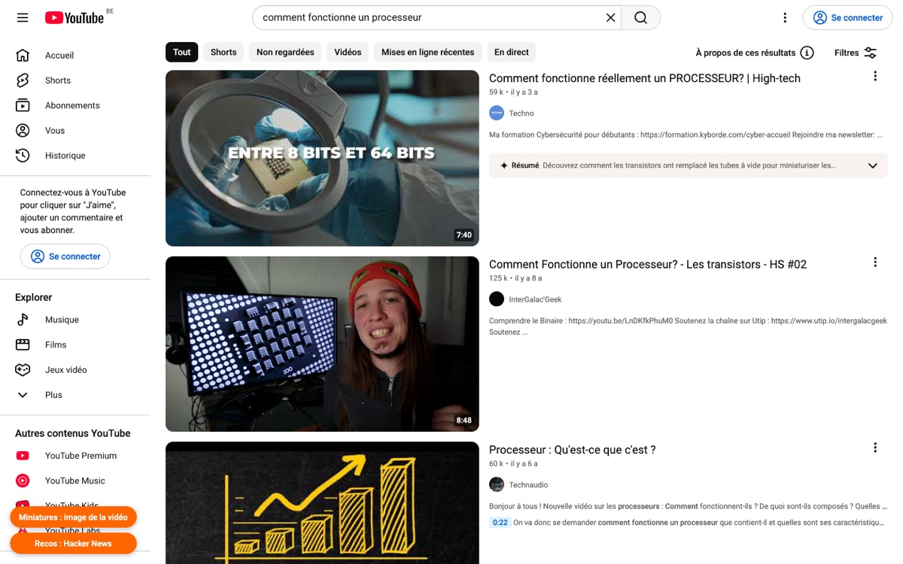
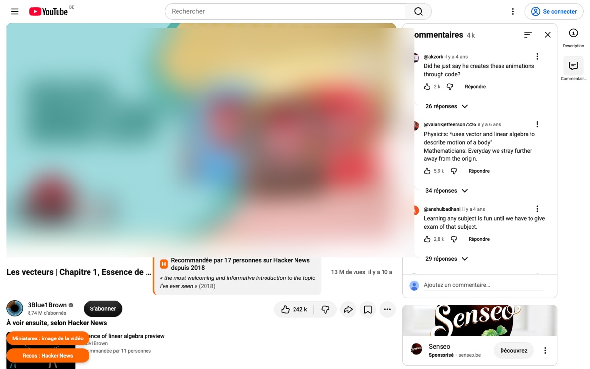

# YouTube sans putaclic

Une extension Chrome qui change deux choses sur YouTube :

- **Les miniatures :** à la place de la miniature choisie par le créateur, tu vois une image prise au milieu de la vidéo.
- **Les recommandations :** l'accueil et les suggestions de droite sont remplacés par des vidéos que des développeurs se recommandent sur Hacker News depuis près de 20 ans.

C'est l'extension de la vidéo Code Simple « YouTube sans putaclic ». Elle a été faite avec Claude Code à partir des données de [HackerTube](https://hackertube.org), le projet d'Andrej Karpathy.


| Miniatures originales | Image du milieu de la vidéo |
|---|---|
|  |  |

Quand une vidéo fait partie de la liste, un badge indique combien de personnes l'ont recommandée et cite un de leurs commentaires. Les suggestions de droite viennent de la même liste.



## L'installer

1. Télécharge ce dépôt : bouton vert **Code**, puis **Download ZIP**. Décompresse-le.
2. Dans Chrome, ouvre `chrome://extensions` et active le **Mode développeur** (en haut à droite).
3. Clique sur **Charger l'extension non empaquetée** et choisis le dossier `extension/`.
4. Recharge YouTube.

Deux boutons apparaissent en bas à gauche de YouTube :
- **Miniatures :** passe de l'image du milieu de la vidéo aux miniatures originales, et inversement.
- **Recos :** passe des recommandations Hacker News à celles de YouTube, et inversement.

Tes réglages et les vidéos déjà vues restent dans ton navigateur. L'extension n'envoie rien nulle part.

## La refaire avec Claude Code

1. Télécharge les données sur [hackertube.org/data](https://hackertube.org/data) et décompresse-les.
2. Ouvre Claude Code dans ce dossier.
3. Donne-lui cette demande :

> Lis DATA.md dans ce dossier. Crée-moi une extension Chrome pour YouTube. Elle remplace l'accueil par ces vidéos, avec des filtres par type et par thème. Elle affiche partout l'image du milieu de la vidéo au lieu de la miniature, avec un bouton pour revenir aux originales. Et sur une vidéo, elle remplace les suggestions de droite par des vidéos proches de la liste.

## Comment c'est fait

- **`scripts/build_data.py`** prépare `extension/data/` à partir du zip HackerTube.
  - Il garde les vidéos recommandées par au moins 2 personnes, soit 3 471 sur 6 454.
  - Il retire l'actualité périmée et les doublons.
  - Il calcule, avec les vecteurs fournis dans le zip, les 12 vidéos les plus proches de chacune.

  Pour reconstruire les données :
  ```
  python3 scripts/build_data.py source/hackertube-data extension/data
  ```
- **L'image du milieu** est celle que YouTube fournit pour chaque vidéo : `https://i.ytimg.com/vi/<id>/hq2.jpg`.
- **`test/test.mjs`** charge l'extension dans Chromium et la vérifie sur le vrai youtube.com (8 vérifications) :
  ```
  cd test && npm install && npx playwright install chromium && node test.mjs
  ```

## Limites

- **La langue :** presque toutes les vidéos sont en anglais.
- **Les données** datent du 31 octobre 2026. Les vidéos supprimées depuis sont masquées automatiquement.
- **La fragilité :** l'extension dépend de la structure des pages de YouTube. Une mise à jour de YouTube peut la casser.

## Crédits et licences

- **Les données** viennent de [HackerTube](https://hackertube.org) et du jeu de données [open-index/hacker-news](https://huggingface.co/datasets/open-index/hacker-news), sous licence [ODC-By 1.0](https://opendatacommons.org/licenses/by/1-0/).
  - Les commentaires restent l'œuvre de leurs auteurs.
  - Les titres et noms de chaînes appartiennent à leurs créateurs.
  - Les résumés et les étiquettes ont été écrits par une IA, donc quelques-uns peuvent être faux.
- **Le code** est sous licence MIT (voir `LICENSE`).
- Ce projet n'a aucun lien avec YouTube, Google, Hacker News ou Y Combinator.
